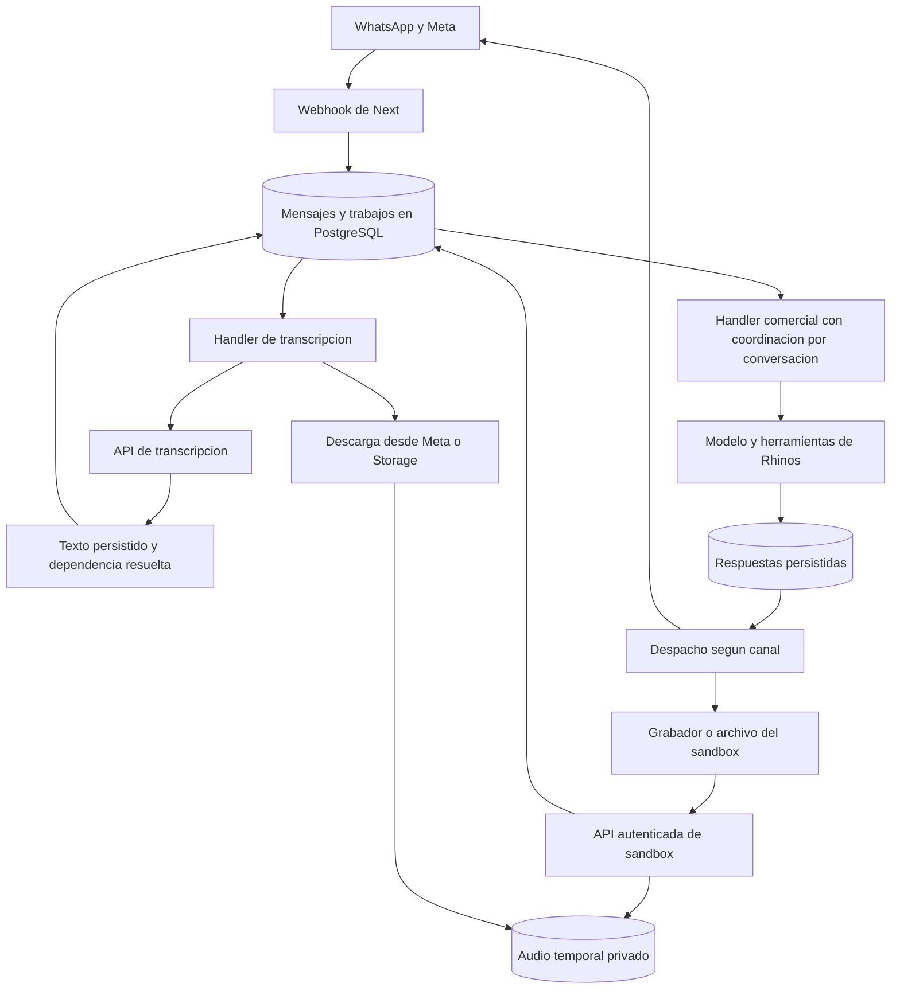

# Plan de implementación de audios para el asistente comercial

Estado: plan propuesto, pendiente de implementación. Fecha: 3 de noviembre de 2026.

El asistente aceptará notas de voz de WhatsApp y audios grabados o adjuntados en
el sandbox. Convertirá el audio en texto, conservará su procedencia y continuará
con las mismas reglas y herramientas comerciales actuales.

La implementación separará transcripción y procesamiento comercial en trabajos
persistentes desde el inicio. Una instancia podrá ejecutar ambos tipos de trabajo
para reducir costos; posteriormente podrán desplegarse grupos de workers
independientes mediante configuración. La escalabilidad se comprobará con varias
instancias y pruebas de recuperación, como parte de la evidencia de la tesis.

## 1. Alcance y decisiones de producto

- WhatsApp: recibir audio, transcribirlo, usarlo como entrada comercial y responder
  en texto. El operador podrá consultar la transcripción y su estado.
- Sandbox: grabar, adjuntar, escuchar antes de enviar, cancelar y ver transcripción,
  respuesta y herramientas usadas. Debe funcionar sin número ni token de Meta y
  sin un daemon activo en su modo de ejecución inicial.
- Mantener catálogo, precios, stock, permisos, confirmación explícita de preventas
  y derivación humana. Una transcripción no autoriza acciones adicionales.
- Usar español rioplatense; admitir nombres comerciales y unidades sin inventar
  palabras que no se hayan pronunciado.
- Primera versión: hasta 120 segundos y 4.000.000 bytes por archivo, verificables
  en el servidor. Son límites de producto configurables, no de capacidad del modelo.
- Formatos iniciales: OGG/Opus de WhatsApp, WebM/Opus y MP4/M4A del navegador,
  además de MP3 y WAV adjuntos. Cada combinación debe pasar la fase 0.
- Conservar la transcripción como parte del historial. Mantener el audio original
  en almacenamiento privado temporal para recuperación y reproducción mientras
  esté disponible; indicar cuando haya vencido su retención.
- Audio vacío, ilegible, demasiado largo o inválido: informar el problema y pedir
  que lo reenvíen o escriban. No ejecutar herramientas comerciales con texto supuesto.

Quedan fuera de esta entrega: respuestas con voz, llamadas en tiempo real,
identificación de personas por voz, separación de hablantes, archivos largos y
entrenamiento u hospedaje de un modelo de reconocimiento propio.

El sandbox conserva su comportamiento actual: consulta datos reales y puede
guardar preventas reales en borrador después de una confirmación y con permiso
`sales.manage`. La demo inicial usará consultas y armado de carrito; la creación
de preventa se probará de forma explícita y controlada.

## 2. Punto de partida y brechas del código actual

| Componente existente | Reutilización y cambio necesario |
| --- | --- |
| `src/modules/whatsapp/server/meta-webhook.ts` | Ya identifica `AUDIO` y conserva el payload; falta validar y extraer la referencia al medio. |
| `src/app/api/webhooks/whatsapp/route.ts` | Ya verifica firma y persiste sin esperar al modelo; mantendrá esa responsabilidad. |
| `whatsapp_messages` | Ya admite `AUDIO`, `content` y `payload`; la transcripción irá en `content`. |
| `agent_jobs` y RPC de reclamo | Ya tienen persistencia, exclusión por trabajo y reintentos; faltan tipos, dependencias y coordinación por conversación. |
| `services/whatsapp-agent/src/server.ts` | Ejecuta trabajos de a uno; necesita roles y concurrencia limitada. |
| `services/whatsapp-agent/src/commercial-agent.ts` | Lee los últimos 32 mensajes y omite trabajos reemplazados; debe esperar audios pendientes sin descartar su transcripción. |
| `services/whatsapp-agent/src/meta-cloud.ts` | Envía antes de persistir el resultado; debe incorporar una salida persistente y tratar resultados inciertos. |
| Ruta y servicio de simulación | Comparten el agente comercial, pero hoy reciben y guardan texto; incorporarán entrada por audio y reutilización de mensajes ya persistidos. |
| `vercel.json` y Dockerfile del worker | Permiten empaquetar el servicio existente; se agregarán roles y un despliegue de ejemplo con workers separados. |

La restricción actual `UNIQUE (source_message_id)` de `agent_jobs` permite un solo
trabajo por mensaje. Debe convertirse en `UNIQUE (source_message_id, job_type)`
para alojar las dos etapas. La ingesta y las consultas que hoy esperan un único
trabajo por mensaje también deben actualizarse.

Los bloqueos actuales de trabajos no impiden que dos instancias procesen trabajos
distintos de una misma conversación. Esa coordinación será un requisito de la
entrega, previo a habilitar varias instancias comerciales.

## 3. Arquitectura y decisiones registradas

### ADR 1. Un repositorio con módulos y ejecutores independientes

Mantener Next, Supabase y el servicio Node actual. Separar contratos, casos de uso,
adaptadores de proveedores y ejecución. Los módulos compartidos vivirán dentro de
`services/whatsapp-agent/src`, que ya es importado por Next y se incluye en la imagen
Docker. Esos módulos no importarán APIs de Next ni componentes de interfaz.

La función de transcripción no conocerá WhatsApp, las rutas HTTP ni las ventas.
Recibirá bytes, formato, idioma y contexto autorizado; devolverá texto y métricas.
Los adaptadores de entrada resolverán permisos, archivos y organización.

### ADR 2. Dos colas lógicas persistentes desde la primera versión

Extender `agent_jobs` con `TRANSCRIBE_AUDIO` y `PROCESS_CONVERSATION`. Cada tipo
tendrá reclamo, concurrencia, reintentos y métricas propios. El scheduler no
mantendrá un trabajo comercial ocupado esperando a que otro worker transcriba.

PostgreSQL será la cola inicial. Su documentación contempla `SKIP LOCKED` para
consumidores de tablas usadas como colas; la consistencia por conversación y las
dependencias se implementarán adicionalmente en nuestras transacciones.
[Referencia de PostgreSQL](https://www.postgresql.org/docs/17/sql-select.html#SQL-FOR-UPDATE-SHARE).

### ADR 3. Roles de ejecución configurables

La misma imagen aceptará `--role=all`, `--role=transcription` o `--role=commercial`.
`all` iniciará consumidores independientes con capacidad acotada para cada tipo;
un audio no bloqueará el bucle que atiende conversaciones listas.

| Despliegue ilustrativo | Distribución |
| --- | --- |
| Piloto | Una instancia con rol `all`. |
| Más conversaciones | Varias instancias `all`, coordinadas mediante la base. |
| Demanda distinta por etapa | Dos instancias `transcription` y cuatro `commercial`. |

La cantidad real se determinará con mediciones y cuotas. Vercel permite ajustar
instancias; actualmente el escalado de daemons se configura manualmente y sus
cuotas limitan la capacidad disponible. Estos ejemplos no son promesas de throughput.
[Escalado](https://vercel.com/docs/daemons/managing-daemons),
[límites de Daemons](https://vercel.com/docs/daemons/limits).

El rol comercial será responsable también de despachar respuestas persistidas.
El rol de transcripción hará mantenimiento acotado de archivos temporales. Ambos
consumidores deben tener planificación propia para evitar hambre de trabajo.

Ejemplo futuro de configuración de roles separados, pendiente de aplicar y
dimensionar. Las dos entradas usan el mismo código y Dockerfile; el worker
combinado debe reducirse o retirarse de la configuración al adoptar esta variante:

```json
{
  "daemons": {
    "audio-worker": {
      "root": "services/whatsapp-agent",
      "entrypoint": "Dockerfile",
      "command": ["node", "dist/server.js", "--role=transcription"],
      "instances": { "iad1": 2 },
      "resources": { "requests": { "memory": "1Gi" } }
    },
    "commercial-worker": {
      "root": "services/whatsapp-agent",
      "entrypoint": "Dockerfile",
      "command": ["node", "dist/server.js", "--role=commercial"],
      "instances": { "iad1": 4 },
      "resources": { "requests": { "memory": "1Gi" } }
    }
  }
}
```

El campo `command` sustituye el comando de la imagen y permite seleccionar el rol.
[Contrato de configuración de Vercel](https://vercel.com/docs/daemons/config-reference).

Ante `SIGTERM`, cada proceso dejará de reclamar trabajo, esperará las operaciones
activas dentro del período de gracia y cancelará llamadas que excedan su deadline.
Las operaciones incompletas quedarán recuperables por lease. La parada no marcará
como exitoso un trabajo que todavía no persistió su resultado.

### ADR 4. Estado recuperable fuera de cada instancia

Mensajes, etapas, dependencias, respuestas y cuotas se guardarán en PostgreSQL.
Los archivos se guardarán en un bucket privado `whatsapp-audio`, con claves
generadas por el servidor y prefijo de organización/conversación/mensaje.

El disco del daemon solo podrá utilizarse temporalmente. Ningún trabajo dependerá
de que sobreviva una instancia. Vercel Daemons actualmente carece de almacenamiento
local persistente. [Límites de Daemons](https://vercel.com/docs/daemons/limits).

### ADR 5. Sandbox con los mismos casos de uso

El sandbox usará inicialmente ejecución `INLINE`: las rutas de Next reclamarán
trabajos de esa sesión y ejecutarán los mismos handlers de transcripción y agente.
La transcripción y el turno comercial se resolverán en solicitudes separadas.
Esto conserva la demo independiente del daemon y de Meta.

La cola distinguirá `execution_mode = INLINE | DAEMON` y
`channel = LOCAL_SIMULATOR | WHATSAPP`. El daemon no reclamará trabajos `INLINE`.
El modo sandbox `DAEMON` podrá habilitarse para validar el despliegue completo:
devolverá `202` y la interfaz consultará el estado. Ambos modos se probarán; el
modo inicial seguirá siendo `INLINE`.

En sandbox encolado, el contexto se reconstruirá desde registros del servidor,
incluido el actor de la sesión. Cada acción comercial volverá a verificar sus
permisos actuales. El cliente no podrá transformar una sesión local en WhatsApp.

### Alternativas y compromisos

| Alternativa | Decisión y compromiso |
| --- | --- |
| Crear un servicio HTTP exclusivo de transcripción desde el inicio | Mantener primero un módulo compartido y trabajos tipados evita agregar comunicación y releases de un servicio adicional. Los contratos permiten extraerlo si necesita recursos propios. |
| Usar un broker dedicado desde el inicio | Conservar PostgreSQL reutiliza la persistencia y las operaciones existentes. Se acepta medir y gestionar su contención, conexiones e índices antes de ampliar carga. |
| Hacer transcripción y agente en un único trabajo indivisible | Separar trabajos permite recuperar y dimensionar cada etapa sin repetir la transcripción al fallar el agente. Requiere implementar dependencias y estados explícitos. |
| Ejecutar todo el sandbox mediante el daemon | Conservar un ejecutor inline y otro encolado requiere pruebas de equivalencia; permite una demo independiente y validar también la arquitectura de producción. |

### Flujo de componentes propuesto



Los handlers pueden ejecutarse en Next para sandbox o en uno o varios daemons.
Las flechas de la cola representan reclamo de trabajos; los workers no reciben
peticiones HTTP entrantes desde el navegador.

## 4. Modelo de datos y contratos de persistencia

Las migraciones serán nuevas y compatibles con los datos existentes. Mantendrán
RLS, referencias compuestas por organización y revocación de RPC operativas a
roles de navegador. Las mutaciones se harán a través de handlers autorizados.

| Entidad | Cambios propuestos |
| --- | --- |
| `whatsapp_messages` | Secuencia estable de recepción por conversación, `received_at` explícito si hace falta distinguirlo de `sent_at`, y transcripción en `content` sin cambiar `message_type = AUDIO`. |
| `whatsapp_audio_uploads` nueva | Reserva de carga del sandbox por organización, actor y `clientMessageId`: sesión, clave inmutable, vencimiento, estado y mensaje final asociado. Permite recuperar también la primera solicitud sin crear otra sesión. |
| `whatsapp_audio_assets` nueva | Un registro por mensaje: origen, media ID, clave de Storage, formato detectado, bytes, duración, hash, estado de almacenamiento y de transcripción, modelo, idioma, uso/costo estimado, fechas de retención y error tipado. |
| `agent_jobs` | `job_type`, `channel`, `execution_mode`, estado `WAITING` para dependencias, lease con vencimiento y token por intento. Unicidad por mensaje y tipo. |
| `whatsapp_conversation_leases` nueva | Exclusión comercial por conversación con dueño, vencimiento y generación creciente para rechazar trabajadores vencidos. |
| `whatsapp_conversations` | Contadores/secuencias de entradas y checkpoint comercial necesarios para preservar el orden y detectar entradas nuevas durante una ejecución. |
| `whatsapp_outbox` nueva | Respuesta lógica única, mensaje fuente, rango de entradas cubierto, canal, estado de despacho, identificador de Meta cuando exista y resultado incierto. |
| `whatsapp_processing_usage` nueva | Reservas por operación y consumo agregado por organización, canal y etapa, con permisos distribuidos de concurrencia y vencimiento de reservas. |

Los nombres de RPC serán versionados para el nuevo protocolo de workers:

- Reclamar trabajo por tipo y modo, filtrando elegibilidad y capacidad del tenant.
- Renovar lease y permisos de concurrencia con el token del intento actual.
- Finalizar transcripción, guardar `content` y resolver dependencias en una sola transacción.
- Reclamar y renovar exclusión comercial por conversación.
- Persistir resultado comercial y salida pendiente en una sola transacción.
- Reclamar/finalizar despacho y registrar resultados inciertos.
- Recuperar trabajos vencidos y limpiar reservas o archivos expirados por lotes.

En todas las RPC, organización, integración, conversación, mensaje y trabajo deben
coincidir. Un identificador válido de otra organización nunca amplía el alcance.
`payload` conservará el evento original; los metadatos propios usarán un espacio
de nombres para evitar colisiones, con el registro de audio como fuente de verdad.

## 5. Orden, concurrencia y recuperación

### Reglas que deben mantenerse con varias instancias

1. Una entrega repetida del webhook genera un mensaje y, como máximo, un trabajo
   de cada tipo. El reenvío intencional de otro mensaje se trata como otra entrada.
2. Las transcripciones de audios distintos pueden ejecutarse en paralelo, incluso
   dentro de una conversación; cada resultado se asocia a su mensaje y secuencia.
3. Un turno comercial espera a que los audios anteriores que necesita hayan
   terminado o tengan un fallo terminal comunicado. No interpreta un audio
   pendiente como un mensaje vacío ni lo descarta por existir un texto posterior.
4. Solo un procesador comercial modifica una conversación a la vez. Conversaciones
   distintas pueden avanzar en paralelo.
5. La toma y liberación de leases se resuelve en transacciones breves. Nunca se
   mantiene una transacción SQL abierta mientras se espera una API externa.
6. Un lease vencido no permite persistir resultados ni ejecutar nuevas mutaciones
   comerciales. Las herramientas internas deben validar token, generación y plazo
   dentro de su transacción, no solo al comienzo del trabajo.
7. Un reinicio recupera etapas incompletas; una transcripción ya persistida no se
   vuelve a solicitar en un reintento comercial.
8. Pausa humana, integración desactivada o módulo apagado impiden acciones y nuevos
   envíos. La reactivación conserva el control explícito del operador.

Un fallo terminal de audio se registrará separado de `content`. Su finalización
desbloqueará las dependencias de manera explícita: si no hay otra entrada útil,
se preparará una respuesta fija de reenvío sin modelo ni herramientas comerciales;
si hay texto posterior, se conservará junto con la indicación del audio fallido.
El fallo no dejará la conversación bloqueada indefinidamente.

El despacho mantendrá exclusión y orden por conversación, además de por salida.
Una salida `UNKNOWN` suspenderá el despacho automático de esa conversación hasta
conciliación o resolución del operador; no impedirá atender otras conversaciones.

La secuencia será asignada bajo bloqueo breve de la fila de conversación. Define
orden de recepción del sistema; los timestamps de Meta se conservan para auditoría
y no se presentan como garantía de orden original de entrega del proveedor.

El scheduler comercial podrá agrupar entradas consecutivas listas y cancelar
trabajos comerciales superados, conservando todas sus entradas. Solo se aplicará
esa optimización después de resolver sus dependencias. El límite actual de 32
mensajes históricos no permitirá omitir entradas todavía sin procesar: esas
entradas se incluirán por checkpoint y se dividirán en lotes acotados si exceden
el presupuesto de contexto.

Si llega una entrada mientras se genera una respuesta, se verificará la revisión
de la conversación antes de las mutaciones y del despacho. Una salida todavía no
enviada podrá cancelarse o recalcularse. Las herramientas conservarán sus
validaciones de cotización y confirmación del mensaje fuente.

### Reintentos y efectos externos

La entrega de trabajos tendrá semántica de al menos una vez. Los cambios locales
usarán unicidad y operaciones idempotentes; las APIs externas requieren distinguir
un rechazo confirmado de un resultado desconocido.

| Falla | Conducta |
| --- | --- |
| Archivo ausente temporalmente o proveedor transitorio | Reintento con backoff, jitter y tope; conservar estado y archivo cuando exista. |
| Formato, duración o tamaño inválidos | Rechazo terminal; respuesta explicativa única, sin llamadas comerciales. |
| Audio sin texto utilizable | Pedir reenvío o texto; no completar contenido por inferencia. |
| `429` del proveedor | Respetar `Retry-After` si está disponible y reducir admisión global. |
| Timeout de transcripción | Intentos limitados; la solicitud previa puede haber generado consumo aunque no recibamos su resultado. |
| Reinicio después de guardar transcripción | Continuar desde procesamiento comercial. |
| Meta acepta y devuelve ID | Guardar ID y resultado; continuar conciliación con los webhooks de entrega. |
| Timeout durante envío o caída después de enviarlo | Marcar `UNKNOWN`; no reenviar automáticamente sin evidencia de que no fue aceptado. Conciliar si hay correlación verificable o pedir revisión del operador. |

La outbox evita regenerar una respuesta ante fallos locales, pero no permite
afirmar entrega externa exactamente una vez. La política para `UNKNOWN` debe
figurar en interfaz, métricas y runbook, incluido el posible envío pendiente de
revisión. Si Meta ofrece correlación del callback para la versión usada, se
validará en fase 0 y se incorporará; nunca se asumirá deduplicación no documentada.

## 6. Recepción y procesamiento de WhatsApp

1. Verificar firma y resolver organización por el número receptor, como hoy.
2. Guardar mensaje, referencia al audio, secuencia y dos trabajos en una transacción:
   transcripción `PENDING` y conversación `WAITING`.
3. Responder al webhook después de persistir. No descargar ni transcribir dentro
   del webhook.
4. El worker de audio obtiene una URL desde el media ID, descarga con autorización
   y límite efectivo de bytes y guarda el archivo en Storage privado. No acepta
   URLs elegidas por el usuario ni guarda tokens en mensajes o logs.
5. Validar contenedor, codec, duración y tamaño reales; reservar cuota y solicitar
   transcripción. Persistir resultado y desbloquear el trabajo comercial.
6. Ejecutar el turno comercial cuando corresponda por horario, pausa y demora.
7. Persistir la respuesta en outbox, volver a comprobar habilitación y despachar.

La obtención de URL y descarga son operaciones disponibles en la colección oficial
de Meta. En cada intento se resolverá nuevamente la URL desde el media ID cuando
sea necesario; no se tratará una URL temporal como almacenamiento permanente.
[Obtener URL](https://www.postman.com/meta/whatsapp-business-platform/request/ptjyi84/retrieve-media-url),
[descargar medio](https://www.postman.com/meta/whatsapp-business-platform/request/zsq66eh/download-media).

La descarga y transcripción serán elegibles fuera del horario comercial para
preparar el mensaje; la respuesta seguirá respetando ese horario y la demora.
Una conversación pausada no iniciará nuevas llamadas de IA. La referencia al medio
se conservará hasta la reactivación; si entonces Meta
ya no entrega el archivo, se registrará el fallo y se pedirá un reenvío. Esta
separación debe reflejarse en los filtros de reclamo y en el costo del piloto.

## 7. Sandbox y contratos HTTP

### Interfaz de usuario

- Elegir cliente y lista como hoy. Para la primera grabación se prepara la sesión.
- Grabar con `MediaRecorder`, seleccionando un formato soportado mediante
  `isTypeSupported`; solicitar micrófono solo después de la acción del usuario.
- Mostrar duración, detener a los 120 segundos, permitir escuchar y descartar.
- Mantener adjuntar archivo como alternativa si el micrófono se rechaza o el
  navegador no permite grabar. Liberar tracks y object URLs al cancelar, reiniciar
  o desmontar el componente.
- Mostrar estados separados: carga, validación, transcripción y respuesta.
- Mostrar la transcripción como contenido del audio; no reenviarla como otro
  mensaje de texto ni permitir editarla silenciosamente. Las correcciones se
  envían como una nueva entrada.
- Ante un error o recarga, consultar el estado existente antes de volver a enviar.

La grabación requiere contexto seguro y permiso del navegador. La selección del
formato se comprobará en Chrome y Safari, incluidos los dispositivos usados para
la demo. [Micrófono](https://developer.mozilla.org/en-US/docs/Web/API/MediaDevices/getUserMedia),
[formatos de MediaRecorder](https://developer.mozilla.org/en-US/docs/Web/API/MediaRecorder/isTypeSupported_static).

### Endpoints nuevos y evolución de la ruta actual

Rutas propuestas bajo `/api/org/[orgSlug]/whatsapp/simulacion`:

| Operación | Contrato y resultado |
| --- | --- |
| `POST /audio/uploads` | Recibe selección o sesión existente, `clientMessageId`, formato y tamaño declarados. Valida actor y módulo, prepara sesión y devuelve referencia de carga y URL firmada a una clave generada por el servidor. |
| Carga directa a Supabase Storage | El navegador envía bytes al bucket privado. La declaración del cliente no reemplaza las validaciones del servidor. |
| `POST /audio/uploads/[uploadId]/complete` | Confirma que el objeto existe, valida metadatos reales y registra una única entrada `AUDIO` con sus trabajos. En `INLINE`, ejecuta la transcripción con lease; en `DAEMON`, devuelve `202`. |
| `GET /audio/[messageId]` | Devuelve estado, transcripción, error recuperable y disponibilidad del archivo para una sesión autorizada. `Cache-Control: no-store`. |
| `GET /messages/[messageId]` | Consulta recuperable del turno para texto o audio: estado, respuesta persistida, herramientas usadas y snapshot autorizado. Permite polling de ejecución encolada y recuperación tras recarga. |
| `POST /` existente | Conserva mensajes de texto y reactivación. Agrega la alternativa `sourceMessageId` para ejecutar el turno de una entrada ya persistida, sin insertar otro mensaje. En modo encolado devuelve `202` y la referencia para consultar el estado. |

El servidor resolverá permisos `whatsapp.read` y `whatsapp.manage` con el modo
`whatsapp_sandbox`, propiedad de sesión y coincidencia de tenant antes de cargar,
transcribir, consultar o ejecutar. El `sourceMessageId` debe ser entrante, de esa
sesión y estar listo. `sales.manage` se vuelve a verificar al crear una preventa.
El esquema admitirá exactamente una operación: texto nuevo, mensaje ya persistido
o reactivación. Una respuesta ya preparada se devolverá sin volver a ejecutar el
modelo ni sus herramientas.

La reserva será idempotente por organización, actor y `clientMessageId`, incluso
antes de que exista una sesión. `complete` se podrá repetir y devolverá el mismo
mensaje. La clave del objeto será inmutable, con sobrescritura deshabilitada;
al finalizar se asociarán hash y tamaño verificados. Una carga incompleta no
disparará el bot y una carga modificada no se reutilizará como una transcripción previa.
Si un handler excede su tiempo, la interfaz mostrará estado recuperable y un
reintento reclamará el mismo trabajo cuando su lease permita recuperarlo.

La carga directa se adopta desde esta entrega para independizar archivos y
procesamiento. Vercel Functions limita los cuerpos a 4,5 MB; el límite de producto
de 4 MB deja margen, pero no se usará base64 ni se hará pasar todo el archivo por
la ruta del agente. [Límite de Vercel](https://vercel.com/docs/functions/limitations).
Supabase proporciona URLs firmadas de carga; su vigencia documentada es de dos
horas, por lo que no se prometerá un TTL configurable de minutos para ese token.
La aplicación comprobará además la vigencia y el propietario de la solicitud.
[Carga firmada](https://supabase.com/docs/reference/javascript/storage-from-createsigneduploadurl).

Los JSON de error incluirán `code`, mensaje para el usuario, `retryable` y el ID
de la operación cuando exista. Usar `400` para contrato inválido, `401/403` para
acceso, `404` para referencias inaccesibles, `409` para trabajo ocupado o estado
incompatible, `413/415/422` para archivo inválido y `429` para cuota. No devolver
errores crudos de proveedores ni URLs con credenciales.

El límite actual de 2.000 caracteres seguirá aplicándose al texto escrito.
Las transcripciones tendrán un límite separado de 12.000 caracteres y nunca se
truncarán silenciosamente para pasarlas por el esquema de mensajes de texto.

## 8. Transcripción y compatibilidad de audio

El contrato `TranscriptionProvider` devolverá texto, modelo, idiomas detectados,
duración/uso cuando existan, ID de solicitud y latencia. El adaptador inicial usará
`POST /v1/audio/transcriptions`, con archivo binario, extensión y MIME correctos.
`OPENAI_API_KEY` se reutiliza exclusivamente en el servidor, siempre que el
proyecto y la clave tengan acceso al endpoint y al modelo.

El modelo inicial será `gpt-transcribe`, configurable por separado del modelo
comercial. El español será una pista de idioma; los nombres del catálogo se
podrán proporcionar como contexto breve y pertinente, sin inducir productos no
pronunciados. No se enviará información innecesaria de clientes al transcriptor.
El endpoint documenta OGG entre los formatos aceptados; aun así, se verificará
OGG/Opus real junto con las grabaciones de navegador antes de habilitar el canal.
[Guía oficial de OpenAI](https://developers.openai.com/api/docs/guides/speech-to-text),
[contrato del endpoint](https://developers.openai.com/api/reference/resources/audio/subresources/transcriptions/methods/create),
[autenticación](https://developers.openai.com/api/reference/overview).

El inspector de audio validará formato y duración desde bytes. El candidato es
`music-metadata`, encapsulado detrás de `AudioInspector`, con versión corregida
y fijada en los lockfiles. Las versiones anteriores a 11.16.0 tienen un aviso
conocido que afecta WebM; no se seleccionarán. Duración desconocida o no finita
será rechazo previo a la llamada paga. Si la fase 0 muestra que el parser no
puede validar las grabaciones objetivo, deberá resolverse la inspección antes
de avanzar, comprobando también su empaquetado en Next y Docker.
[Biblioteca](https://github.com/borewit/music-metadata),
[aviso y versión corregida](https://github.com/advisories/GHSA-5gfj-9q3v-qfp3).

La entrega inicial enviará los formatos verificados directamente. La conversión
se mantendrá detrás de un adaptador opcional: incorporar FFmpeg solo si las pruebas
demuestran que es necesario, con sus límites y empaquetado documentados.

La fase 0 fijará una versión compatible de Node para Next y el daemon y verificará
los requisitos de la dependencia elegida. Cada llamada HTTP tendrá `AbortSignal`
y deadline; los límites del proceso completo no dependerán solo del timeout de
una llamada individual.

## 9. Configuración, consumo y retención

| Configuración propuesta | Valor inicial o criterio |
| --- | --- |
| `WHATSAPP_AUDIO_ENABLED` | `false` al desplegar; interruptor global de admisión de audio. |
| Habilitación de audio por organización y canal | Dos flags independientes, inicialmente apagados, subordinados a los módulos existentes. |
| `WHATSAPP_AGENT_TRANSCRIPTION_MODEL` | `gpt-transcribe`. |
| `WHATSAPP_AGENT_WORKER_ROLE` | `all`; `--role` prevalece para declarar daemons distintos con la misma imagen. |
| `WHATSAPP_AGENT_AUDIO_CONCURRENCY` | `1` por instancia en el piloto. |
| `WHATSAPP_AGENT_COMMERCIAL_CONCURRENCY` | `1` por instancia en el piloto. |
| Límites globales y por organización | Permisos distribuidos, con límite inicial bajo y validación contra las cuotas reales de OpenAI; no basta un contador local por proceso. |
| `WHATSAPP_AUDIO_MAX_BYTES` | `4000000`. |
| `WHATSAPP_AUDIO_MAX_SECONDS` | `120`. |
| `WHATSAPP_AUDIO_TRANSCRIPTION_TIMEOUT_MS` | `45000`; calibrar con los archivos de fase 0. |
| Deadline de un handler completo | 90 segundos en daemon y hasta 50 segundos por solicitud inline dentro del límite actual de 60 segundos de la ruta. La UI recupera estado entre solicitudes. |
| Lease y heartbeat de trabajos | 180 y 30 segundos inicialmente; renovación condicionada al token actual. |
| Cuota diaria del piloto | Propuesta: 100 audios por organización, sumando sandbox y WhatsApp; reserva transaccional antes de procesar y métricas separadas por canal. |
| Retención de audio finalizado | 24 horas desde el estado terminal. |
| Retención máxima de audio pendiente | 7 días; al vencer, fallo terminal visible y desbloqueo explícito del flujo. |

La cuota por cantidad se complementará con minutos reservados/consumidos y un
presupuesto global configurable. Reservar la duración máxima cuando todavía no
esté verificada y reconciliar después. Una reserva no se libera como consumo
cero cuando una llamada paga pudo ejecutarse y su resultado es desconocido.

La política de selección aplicará reparto entre organizaciones y capacidad por
tipo de trabajo, evitando que una sola empresa monopolice la cola. La cuota y
la retención son valores iniciales del piloto, ajustables sin modificar el bot.

Al 3 de noviembre de 2026, el precio publicado de `gpt-transcribe` es
USD 0,0045/minuto: 100 minutos equivalen a USD 0,45 y 1.000 a USD 4,50, solamente
por transcripción. La misma cuenta factura ese consumo; se suman agente, Meta,
almacenamiento y ejecución según corresponda. Registrar tarifas con fecha y
distinguir costo estimado de importe facturado. [Precio oficial](https://developers.openai.com/api/docs/models/gpt-transcribe).

La limpieza eliminará objetos con APIs de Storage, nunca borrando únicamente sus
filas internas. Contemplará cargas huérfanas, objetos reintentados, archivos
expirados y eliminación de una conversación/organización. Un archivo que está
siendo usado por un lease válido no se elimina. Los tokens de carga ya emitidos
pueden seguir vigentes: la limpieza de huérfanos debe repetirse después de que
venzan, aunque la solicitud de la aplicación ya se haya cancelado.

Para sandbox `INLINE` sin daemon, un endpoint interno autenticado de mantenimiento
ejecutado cada hora por el scheduler de la plataforma usará el mismo caso de uso
de limpieza. Tendrá exclusión en PostgreSQL y lotes acotados, para coexistir con
el mantenimiento del daemon. La retención no dependerá de que el usuario vuelva
a abrir el sandbox. Incluir este endpoint y su programación en el despliegue.
[Programación y protección de Cron Jobs](https://vercel.com/docs/cron-jobs/manage-cron-jobs).

## 10. Observabilidad y pruebas de capacidad para la tesis

Cada operación tendrá correlación por mensaje, trabajo, etapa y ejecución.
Los logs no incluirán audio, transcripción, tokens ni URLs firmadas. El historial
autorizado será el lugar para consultar el contenido.

Medir: entradas por minuto, profundidad y antigüedad de cada cola, espera y tiempo
de servicio p50/p95/p99, reintentos, leases vencidos, errores por proveedor, minutos
de audio, costo estimado, salidas `UNKNOWN` y reparto por organización. Separar
espera técnica de demoras comerciales configuradas.

Objetivos provisionales de aceptación, a verificar con mediciones:

- Sin pérdida de mensajes ni preventas duplicadas en los escenarios de fallos.
- Sin dos mutaciones comerciales simultáneas de una conversación.
- Transcripción p95 de hasta 20 segundos para notas de voz de hasta 60 segundos,
  a la carga declarada para el piloto. Es un objetivo, no una garantía del proveedor.
- Para la carga operativa declarada, espera técnica p95 de hasta 5 segundos por
  etapa. Excluye horario, demora comercial y backoff indicado por el proveedor.
- Demostrar actividad simultánea de workers y progreso de varios tenants;
  documentar el factor de mejora medido y sus límites, sin asumir escalado lineal.

La prueba de capacidad usará un harness contra PostgreSQL de prueba y proveedores
simulados con latencia y fallos controlados. Escenarios mínimos: 1, 2 y 4 workers;
20 y 100 conversaciones; mezcla 70% texto/30% audio; ráfaga de 100 entradas; dos
organizaciones con cargas desiguales; tres audios consecutivos y texto posterior
en la misma conversación. Son cargas de ensayo propuestas, no proyecciones del negocio.

Medir saturación, drenaje de cola, CPU/memoria de DB y workers, conexiones,
contención de locks y costo. Para atribuir el efecto de cada rol, ejecutar también
dos workers de transcripción y dos comerciales. Las pruebas con proveedores reales
serán acotadas, con presupuesto explícito del ensayo y datos de prueba; no se usarán
clientes reales para generar carga artificial.

Conservar dataset de prueba, parámetros, commits, versiones, semillas, resultados
y limitaciones como evidencia reproducible. Un corpus de al menos 20 audios
controlados evaluará nombres, marcas, kilos/piezas y confirmaciones; los errores
con ambigüedad detectable deben conducir a aclaración y no a una compra supuesta.
Registrar también errores no detectados: el reconocimiento de voz es
probabilístico. La cotización resumida y la confirmación explícita continúan
siendo necesarias; no se afirmará que todo error de reconocimiento es detectable.

## 11. Fases de implementación y criterios de salida

| Fase | Trabajo | Criterio de salida |
| --- | --- | --- |
| 0. Contratos y compatibilidad | Verificar acceso con la clave existente, límites, OGG/Opus, WebM y MP4 reales, duración desde bytes, versión del parser, reproducción y empaquetado. Confirmar contrato de descarga/callback de Meta. | Matriz de formatos y costo/latencia básica; resolver cualquier incompatibilidad que impida validar duración o transcribir. |
| 1. Persistencia y coordinación | Migraciones de trabajos tipados, secuencias, audio, leases, outbox, cuotas, flags y Storage privado. RPC v2 y compatibilidad con consumidores anteriores. | Pruebas SQL concurrentes, RLS y recuperación pasan con dos consumidores; sin llamadas a proveedores. |
| 2. Handlers y ejecutores | Implementar inspección, Storage, proveedor, transcripción, dependencias, roles, heartbeat, concurrencia y parada ordenada. Integrar outbox y revalidación de herramientas. | Dos roles separados y rol combinado consumen la misma cola sin duplicar efectos locales ni cruzar conversaciones. |
| 3. Sandbox demostrable | Grabación/carga, sesiones, endpoints idempotentes, transcripción y turno separados, estados recuperables, reproducción y modo encolado de validación. | Demo completa en Chrome y Safari con micrófono o archivo; sin Meta ni daemon en `INLINE`. |
| 4. WhatsApp e inbox | Ingesta por etapas, descarga autorizada, horarios, flags, transcripción visible, errores terminales y respuestas persistidas. | Prueba real con número de prueba; audio seguido de texto conserva todo el contenido y no genera preventas duplicadas. |
| 5. Resiliencia y capacidad | Matriz adversarial, pruebas con 1/2/4 workers, mediciones, reparto de tenants, retención y cuotas. | Evidencia reproducible y límites medidos; resolver fallos de consistencia antes de activar múltiples instancias. |
| 6. Despliegue y tesis | Runbook, manifiestos combinado/separado, migración progresiva, reversión, ADR y resultados de evaluación. | Piloto habilitado por organización/canal con monitoreo y procedimiento probado de recuperación. |

El primer hito visible será el sandbox de fase 3. El feature se considerará
terminado al completar también WhatsApp, pruebas con varios workers y documentación
operativa. La fase 0 es una comprobación acotada de integración, no una migración
general de modelos ni un cambio de arquitectura comercial.

## 12. Mapa de archivos y entregas

| Área | Archivos existentes o propuestos |
| --- | --- |
| Contratos y handlers compartidos | Nuevos `services/whatsapp-agent/src/audio/*`, `jobs/*`, coordinación y despacho; sin dependencia de Next. |
| Worker | `server.ts`, `worker.ts`, `commercial-agent.ts`, `meta-cloud.ts`, sus tests y `Dockerfile` si aparece una dependencia nativa. |
| Webhook y validaciones | `src/modules/whatsapp/server/meta-webhook.ts`, su test y la ruta de webhook. |
| Sandbox | `src/components/whatsapp/whatsapp-agent-simulator.tsx`, componente de captura separado, `server/simulation.ts`, ruta actual y nuevas rutas de audio y estado del turno. |
| Permisos y herramientas | `src/modules/whatsapp/server/access.ts`, `commercial-tools.ts` y API interna para verificar leases, versión y actor del sandbox. |
| Inbox | `src/modules/whatsapp/service/whatsapp-conversations.service.ts`, componentes de conversación y estados/reproducción de audio. |
| Base y Storage | Nuevas migraciones de noviembre con identificadores únicos, fixtures, pruebas SQL y tipos generados si corresponde. No reescribir migraciones históricas. |
| Verificación y release | `scripts/test-whatsapp-db.sh`, `scripts/build-whatsapp-release-sql.mjs`, scripts reproducibles de carga y pruebas de actualización. |
| Configuración | `.env.example`, `vercel.json`, manifiesto de ejemplo separado, endpoint interno y programación de limpieza, README del servicio y ambos lockfiles si se agregan dependencias. |
| Documentación | `docs/whatsapp-agent.md`, `docs/whatsapp-deploy.md`, decisiones de este plan y resultados de las pruebas. |

Las entregas serán incrementales: contratos/base; ejecución/roles; sandbox;
WhatsApp/inbox; capacidad/despliegue. Cada una debe conservar el flujo de texto
existente. Los cambios de coordinación afectan también a texto y requieren sus
pruebas de regresión, aun cuando el audio siga deshabilitado.

## 13. Matriz mínima de verificación

- Unitarias: normalización y límites; duración no finita; formatos reales y
  archivos truncados; error del proveedor; salida vacía; cuota; reintentos;
  habilitación por canal; selección de rol y configuración requerida por rol.
- Base concurrente: doble webhook; dos reclamos del mismo trabajo; dos trabajos
  de una conversación; conversaciones distintas en paralelo; caducidad y
  renovación de leases; rechazo de token viejo; resolución atómica de dependencias.
- Persistencia: caída antes y después de guardar transcripción; caída antes y
  después de persistir outbox; limpieza concurrente; cargas huérfanas y expiradas.
- Entrega: Meta rechaza; acepta; devuelve respuesta inválida; timeout después de
  aceptación simulada; webhook repetido o fuera de orden; despacho `UNKNOWN`
  visible y sin reenvío automático.
- Conversación: audio/texto; varios audios; audio fallido seguido de texto;
  confirmación por voz; negación; cambio de cotización; llegada durante el modelo;
  pausa/reactivación; cierre de carrito; más de 32 entradas pendientes.
- Aislamiento: IDs de otra organización; sesión de otro actor; permisos revocados
  entre carga y procesamiento; módulo apagado durante la ejecución; sandbox
  encolado sin permiso de ventas; intento de envío a Meta desde simulación.
- Navegador: permiso de micrófono concedido/rechazado, cancelación, doble clic,
  navegación durante grabación, recarga, reinicio de sesión, archivo sin audio y
  recuperación después de un timeout, en Chrome y Safari.
- Despliegue: consumidores viejo/nuevo durante actualización; bundle SQL vacío y
  existente; ejecución repetida de migración; rol combinado y roles separados;
  `SIGTERM` con trabajos activos; retroceso de aplicación con esquema expandido.

Durante la implementación, ejecutar las pruebas Vitest pertinentes de aplicación y
servicio, typecheck del worker, verificación de Next, lint de archivos afectados,
build de ambos targets y `scripts/test-whatsapp-db.sh` contra base descartable.
Las pruebas de capacidad serán separadas de la suite rápida y conservarán reportes.

## 14. Despliegue progresivo y reversión

1. Aplicar esquema expandido, flags apagados y protocolo compatible. Clasificar
   trabajos existentes como `PROCESS_CONVERSATION`; no transcribir audios
   históricos ni responder nuevamente a clientes por un backfill.
2. Mantener la firma de la RPC antigua y su semántica de retorno, filtrando solo
   trabajos comerciales del protocolo anterior. Al existir varios trabajos por
   mensaje, la ingesta devolverá explícitamente el ID comercial esperado por su
   contrato anterior. La ruta nueva utilizará el protocolo versionado.
3. Evitar que consumidores antiguos reclamen mensajes con audio pendiente o
   conversaciones controladas por el nuevo protocolo. Registrar la versión de
   ejecución y probar la convivencia durante el rollout.
4. Desplegar handlers/rutas/worker con audio apagado, verificar readiness por rol,
   Storage, RPC y variables. La configuración de un transcriptor no debe exigir
   los secretos de herramientas comerciales que no utiliza.
5. Completar demo y pruebas de sandbox; habilitar su flag en una organización.
6. Habilitar WhatsApp de prueba y luego una organización piloto. Observar cola,
   resultados inciertos, minutos y costo antes de aumentar instancias.
7. Para separar roles, desplegar dos entradas de daemon con la misma imagen y
   distinto `command --role`; aumentar sus instancias dentro de las cuotas.
   Reducir el consumidor combinado sin perder trabajo y respetando los leases.

Ante una falla, apagar admisión de nuevos audios y detener reclamos afectados.
Conservar mensajes, objetos y trabajos para recuperación; permitir que trabajo
válido termine o que su lease venza. La reversión de la aplicación mantendrá el
esquema expandido: no eliminar tablas ni transcripciones para volver atrás. Una
versión antigua solo retomará texto elegible cuando el protocolo lo permita.
No reenviar salidas `UNKNOWN` ni reprocesar preventas como parte del rollback.

## 15. Evidencia y evolución futura

La entrega de tesis incluirá el diagrama, las decisiones y alternativas, los
contratos, el modelo de fallos, la matriz de formatos, las pruebas concurrentes,
los ensayos de carga y un runbook de operación/recuperación. Cada resultado deberá
identificar escenario, recursos, versiones y cuotas; diferenciar capacidad medida
de objetivos o estimaciones.

| Señal observada | Evolución prevista |
| --- | --- |
| Cola de audio crece y la comercial está dentro del objetivo | Aumentar instancias de transcripción respetando cuotas y presupuesto. |
| Cola comercial crece con capacidad del proveedor disponible | Aumentar workers comerciales; conservar exclusión por conversación. |
| Conversión de archivos necesita recursos o dependencias propias | Extraer conversión/inspección a un worker especializado con el mismo contrato de medios. |
| La cola en PostgreSQL genera contención o perjudica consultas del negocio | Evaluar un broker dedicado, manteniendo handlers, IDs, deduplicación y outbox; migrar de manera controlada sin doble consumo. |
| Se requiere escalado automático o condiciones operativas distintas | Cambiar el ejecutor/plataforma de workers conservando imagen, contratos y estado externo; documentar sus garantías. |
| Se necesitan audios más largos | Ampliar límites, retención y cuotas tras probar duración, memoria y latencia; mantener la carga directa y trabajos asíncronos. |

La base de datos y los proveedores seguirán siendo recursos compartidos al
aumentar instancias. Sus límites se medirán junto con los del worker. La propiedad
de escalabilidad se considerará demostrada para los escenarios ensayados, con un
procedimiento verificable para ampliar capacidad y evaluar el siguiente límite.

## 16. Checklist de cierre

- [ ] Compatibilidad real de WhatsApp y navegadores verificada desde bytes.
- [ ] Clave existente habilitada y consumo medido por separado de respuestas.
- [ ] Sandbox con micrófono y archivo, sin Meta ni daemon en modo inicial.
- [ ] WhatsApp real con transcripción persistida y visible.
- [ ] Roles combinado y separados probados con la misma imagen.
- [ ] Dos conversaciones progresan simultáneamente; una misma conversación mantiene orden.
- [ ] Audios pendientes sobreviven a texto posterior y reinicios.
- [ ] Reintentos locales no duplican preventas ni respuestas persistidas.
- [ ] Resultados inciertos de envíos visibles y recuperables sin reenvío ciego.
- [ ] Cuotas distribuidas, permisos por tenant/canal y retención comprobados.
- [ ] Migración, despliegue gradual y reversión probados.
- [ ] Resultados de capacidad y decisiones disponibles para la tesis.
